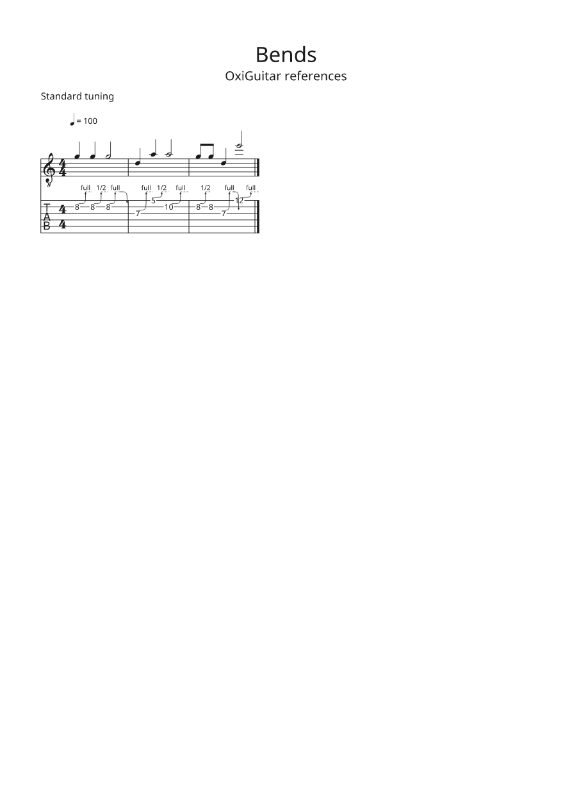
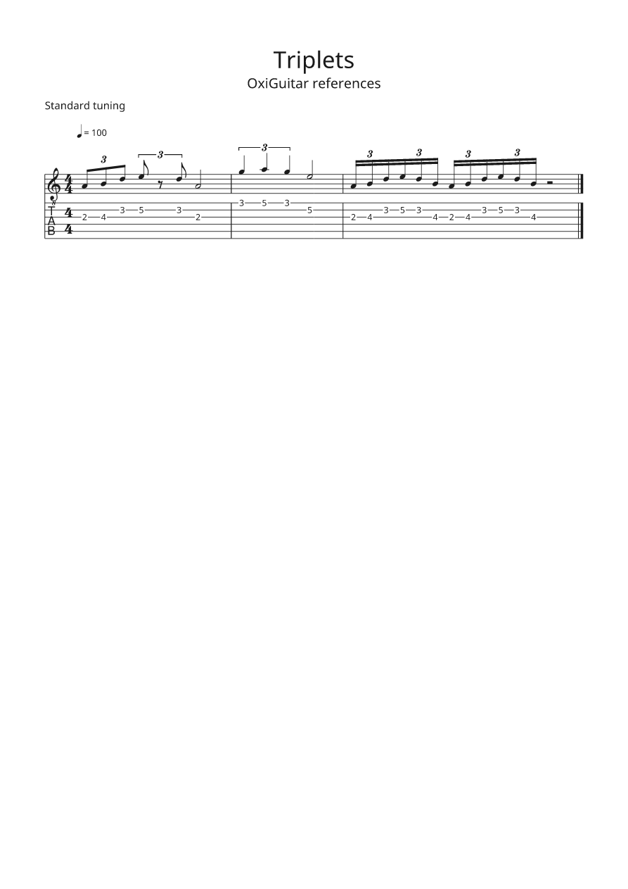

# oxiguitar-guitarpro

The Guitar Pro plugins for [OxiGuitar](https://github.com/mateusrdp/oxiguitar), a free, open-source guitar tablature and score viewer, editor and player for Windows, macOS and Linux. They are what lets OxiGuitar open, and for Guitar Pro 5 and 7-8 also save, the files that tab collections have been kept in since the 90s.

| Plugin file | Id | Reads | Writes |
| --- | --- | --- | --- |
| `gp3.oxp` | `oxiguitar.gp3` | Guitar Pro 3 (.gp3) | |
| `gp4.oxp` | `oxiguitar.gp4` | Guitar Pro 4 (.gp4) | |
| `gp5.oxp` | `oxiguitar.gp5` | Guitar Pro 5 (.gp5) | .gp5 |
| `gpx.oxp` | `oxiguitar.gpx` | Guitar Pro 6 (.gpx) | |
| `gp.oxp` | `oxiguitar.gp` | Guitar Pro 7 and 8 (.gp) | .gp |

Each file holds only its own reader, so you can leave out the ones you do not need. The file type is always decided from the file's contents, never from its extension: a Guitar Pro 5 file named `.gp3` opens as Guitar Pro 5.





The pictures are OxiGuitar engraving two of the reference songs in [`fixtures/reference/`](fixtures/reference/), which we wrote ourselves. The plugins have no sound of their own: they only read the file. What you hear comes from [oxiguitar-midi](https://github.com/mateusrdp/oxiguitar-midi) and an audio output plugin.

## Install

Every [release](https://github.com/mateusrdp/oxiguitar-guitarpro/releases) holds a zip per system (Linux x86_64 and ARM64, Windows x86_64 and ARM64, macOS), a `.deb` and an `.rpm` for Linux, a per-user installer for Windows (no administrator needed), a `.pkg` for macOS, and a `SHA256SUMS` file. The OxiGuitar manual's [install page](https://mateusrdp.github.io/oxiguitar/installing.html) says which one to use and how to keep the plugins updated through your package manager.

You can also copy the `.oxp` files from a zip into OxiGuitar's plugin folder by hand ([Settings and plugins](https://mateusrdp.github.io/oxiguitar/plugins.html)).

## Build and test

Rust 1.99 or later from [rustup](https://rustup.rs). The plugin SDK and the score model come from OxiGuitar's repository by git tag (plugin interface 1.6, pinned to OxiGuitar's v0.17 pull request until `v0.17.0` is tagged); nothing of OxiGuitar's is on crates.io.

```sh
cargo test --workspace      # the readers, the writers, and the five plugins as .oxp files
./build-oxp.sh              # dist/gp3-VERSION-SYSTEM-ARCH.oxp, and the other four
```

`cargo test` builds each plugin as the `.oxp` file we ship and checks it through OxiGuitar's own plugin host (the contract suite of `oxiguitar-plugin-test`), then reads every public fixture through the five files and compares the result with reading it in the same process. [CONTRIBUTING.md](CONTRIBUTING.md) has the rest of the rules.

What is where:

- `plugins/gp3`, `gp4`, `gp5`, `gpx`, `gp`: the five plugins, thin crates over the readers.
- `crates/oxiguitar-formats`: file format detection, the readers and the writers.
- `fixtures/`: our own songs in every format, and the files we write for checking in Guitar Pro itself (`fixtures/guitar-pro-check/`).
- `fuzz/`: fuzz targets for every reader and the writers ([fuzz/README.md](fuzz/README.md)).
- `corpus/`: the manifest of a private test collection. The files are never committed.
- `scripts/interop/`: checks that alphaTab and MuseScore read the files we write as we mean them.

## Releases

A release is made by the maintainer pushing a `v*` tag (`v` plus the version in `Cargo.toml`) on `main`. [`release.yml`](.github/workflows/release.yml) then builds the five plugins for every system with OxiGuitar's reusable [plugin-release workflow](https://github.com/mateusrdp/oxiguitar/blob/develop/.github/workflows/plugin-release.yml), makes the packages and a draft release; publishing the draft starts [`publish.yml`](.github/workflows/publish.yml), which tells the package repositories. Every pull request gets the same builds as test builds, kept for 14 days under its Release run.

## History

These plugins lived in the [OxiGuitar repository](https://github.com/mateusrdp/oxiguitar) until its version 0.11.0. Their history came along (`git log` and `git blame` reach back to the first reader); an issue number such as `mateusrdp/oxiguitar#123` in an old commit message is in that repository.

## Licence

GPL-3.0-or-later. See LICENSE. Contributions are welcome under the same terms; see [CONTRIBUTING.md](CONTRIBUTING.md).

Guitar Pro is a trademark of Arobas Music. OxiGuitar is not affiliated with it.
