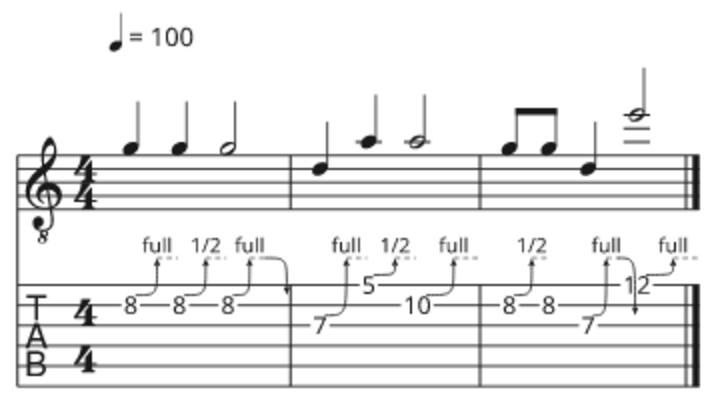

# Guitar Pro plugins

These plugins let OxiGuitar open Guitar Pro files, the format most tab collections have been kept in since the late 1990s. Without them OxiGuitar can't open a `.gp5` or a `.gp` at all: every file format is a plugin. There are five, one for each generation of the format, and the ones for Guitar Pro 5 and for Guitar Pro 7 and 8 can also save.

| Plugin file | Opens | Saves |
| --- | --- | --- |
| `gp3.oxp` | Guitar Pro 3 (.gp3) | |
| `gp4.oxp` | Guitar Pro 4 (.gp4) | |
| `gp5.oxp` | Guitar Pro 5 (.gp5) | .gp5 |
| `gpx.oxp` | Guitar Pro 6 (.gpx) | |
| `gp.oxp` | Guitar Pro 7 and 8 (.gp) | .gp |

They only read and write files. They make no sound, so you also need a plugin that plays scores and one that sends the sound to your speakers.

## Tablature and Guitar Pro

Guitarists mostly read **tablature** ("tab"): six lines, one for each string, with a number on a line saying which fret to press on that string. It shows *where* to play a note, which standard notation doesn't, and it can show what guitarists do with a note: bends, slides, hammer-ons, vibrato, palm mutes. Guitar Pro files hold both at once, the notes in standard notation and the same notes as tab, plus the rhythm, the tempo and every track of the band.

**Guitar Pro**, by the French company Arobas Music, is the program most of that tab was written in. Because it could play the tab back, guitarists shared its files by the million, and most sites and collections still offer them. Its file format changed with the program:

- **Guitar Pro 3, 4 and 5** (`.gp3`, `.gp4`, `.gp5`) wrote compact binary files, each version adding to the one before.
- **Guitar Pro 6** (`.gpx`) moved to an XML description of the score, called GPIF, inside a compressed container of Arobas's own.
- **Guitar Pro 7 and 8** (`.gp`) keep the GPIF XML, now inside an ordinary ZIP archive.

OxiGuitar opens them all, whatever their extension says: it looks inside the file to decide which generation it is. It saves to `.gp5`, which Guitar Pro 5 and later and TuxGuitar can read, and to `.gp`, for Guitar Pro 7 and later.

Guitar Pro is a trademark of Arobas Music. OxiGuitar is not affiliated with it.
