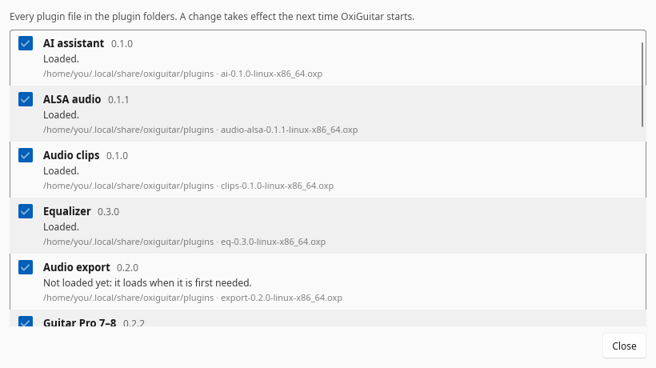

# How to use it

## Check it is installed

**Tools → Plugins…** lists every plugin OxiGuitar found, with its version, and lets you switch any of them off:

## Open and save

- **Open**: **File → Open…** and pick a `.gp`, `.gpx`, `.gp5`, `.gp4` or `.gp3` file, or double-click one if your system links the file type to OxiGuitar. OxiGuitar looks inside the file to decide which plugin reads it; the extension doesn't matter.
- **Save**: **File → Save As…** and pick `.gp5` or `.gp` as the format. If the format can't hold everything in your score, OxiGuitar says what would be lost before it saves, and you can keep the rest in the `.oxg` file beside it.
- **The import log**: anything the Guitar Pro plugins couldn't bring across is listed in the footer at the bottom of the window when the file opens.

## What you can do with it

- Open an old tab collection. Files from Guitar Pro 3, 4 and 5 open as they are, and so do files from Guitar Pro 6, 7 and 8.
- Edit a song and save it back in a format other people can open. Saving as .gp5 gives a file that Guitar Pro 5 and later, and TuxGuitar, can read. Saving as .gp gives a file for Guitar Pro 7 and later.
- Install only the generations you use. Each plugin is a separate file, so a collection that is all .gp5 needs only `gp5.oxp`.
- Open a file with the wrong extension. OxiGuitar looks inside the file to decide what it is, so a Guitar Pro 5 file named `.gp3` opens as Guitar Pro 5.

When a format can't hold something you added, OxiGuitar says what would be lost before it saves.
